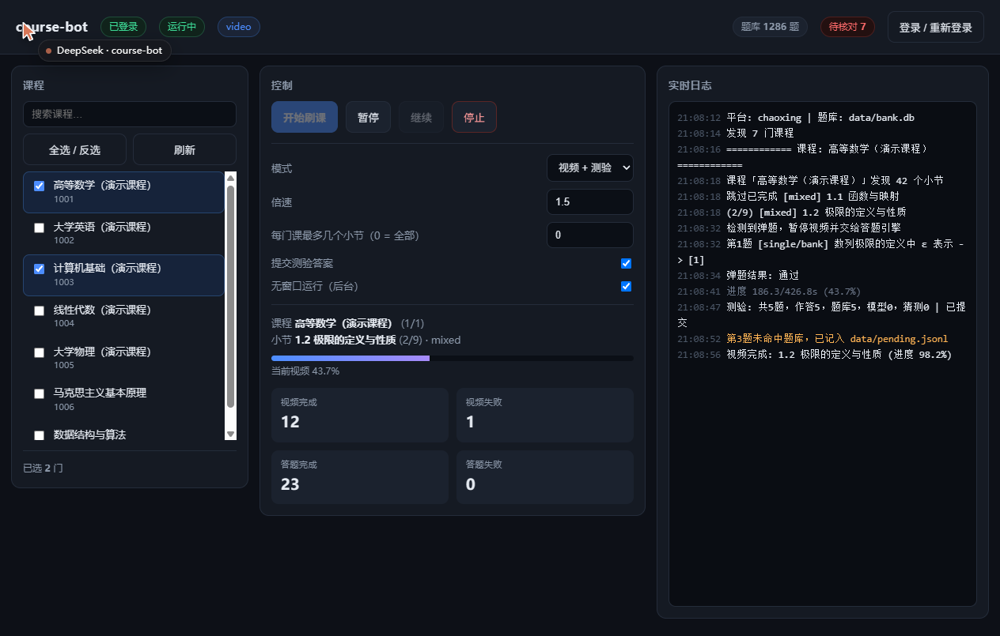

# course-bot

超星学习通 / 智慧树的课程自动化工具：自动推进视频进度、拦截弹题、完成章节测验，自带 Web 控制台和本地题库。

[](https://www.python.org/)
[](LICENSE)
[](#)
[](https://playwright.dev/)



---

## 特性

| | 说明 |
| --- | --- |
| **Web 控制台** | 勾选课程、开始 / 暂停 / 继续 / 停止，实时看进度和日志 |
| **真暂停** | 暂停时播放器立刻 `pause()`，进度冻结，继续时从原位置接着播 |
| **倍速守护** | 覆写 `HTMLMediaElement.playbackRate` 的 setter，平台把速度改回 1.0 也能拉回来 |
| **弹题拦截** | 播放中轮询弹题容器，命中即暂停、交给答题引擎、答完继续播 |
| **本地题库** | SQLite，归一化 hash 精确命中 + 相似度回捞，命中/失配都有统计 |
| **AI 兜底** | 题库未命中时走任意 OpenAI 兼容接口，答完自动回写题库 |
| **无把握留痕** | 既没命中题库也没模型答案的题写入 `pending.jsonl`，前端计数提醒 |
| **断点续跑** | `progress.json` 记录每个小节状态，中断后自动跳过已完成的 |
| **持久登录** | Playwright 持久化 profile + `storage_state` 双保险，扫码一次长期有效 |

## 目录

- [快速开始](#快速开始)
- [操作流程](#操作流程)
- [界面说明](#界面说明)
- [配置](#配置)
- [答题正确率](#答题正确率)
- [题库](#题库)
- [命令行](#命令行)
- [常见问题](#常见问题)
- [工作原理](#工作原理)
- [迁移到其他电脑](#迁移到其他电脑)
- [开发](#开发)

---

## 快速开始

### 环境要求

- Python **3.10+**（安装时务必勾选 *Add Python to PATH*）
- 一个能正常登录课程的浏览器账号（扫码或账密）
- Chrome / Edge 任一即可；没有的话 `install.bat` 会尝试下载 Playwright 内置内核

### 三步跑起来

```bash
# 1. 装依赖（Windows 双击 install.bat 也可以）
pip install -r requirements.txt

# 2. 初始化配置
python main.py init

# 3. 打开控制台
python main.py serve --port 8000
```

浏览器打开 <http://127.0.0.1:8000>，剩下的都在网页里点。

Windows 上更省事：双击 **`start.bat`**，它启动服务并自动打开浏览器。

---

## 操作流程

以下是第一次使用的完整路径，每一步都写了「做什么 / 看到什么 / 出问题怎么办」。

### 步骤 0 · 确认环境

```bash
python --version          # 需要 3.10 或更高
python main.py doctor     # 环境自检
```
正常输出：

```text
Python: 3.10.11
[OK]   playwright
[OK]   playwright.async_api
[OK]   bank  0 道题
```
`bank 0 道题` 是正常的，题库还是空的。若 `playwright` 显示 `[MISS]`，执行：

```bash
pip install -r requirements.txt
```
### 步骤 1 · 首次登录

在控制台点右上角 **「登录 / 重新登录」**，会弹出一个浏览器窗口。

在窗口里扫码（或输账号密码）完成登录。程序每 3 秒检查一次凭证 cookie，检测到 `_uid` 之类的票据就自动关窗并保存。

```text
登录态已保存: .profiles\state.json
已获取票据 cookie: UID, _uid, p_auth_token, fid, ... 共 20 项
```
> **为什么只认 cookie 不认 URL**：扫码后页面会先跳到中转页，此时 `fid` 已种下但 `_uid` 还没有。按 URL 判断会提前收工，后续所有请求都被踢回登录页。

登录态保存在 `.profiles/`，之后的启动直接复用，不用反复扫码。

### 步骤 2 · 拉取课程

点左侧 **「刷新」**，约 15 秒（会临时起一次无头浏览器）。

```text
军事理论（首批国家级一流课程）        255068726
人工智能应用基础微认证 L3              267656716
电工基础                              208272863
...
```
若列表为空，见 [常见问题](#拉不到课程列表)。

### 步骤 3 · 选课与参数

在左侧勾选要刷的课（支持搜索框过滤、全选 / 反选），然后在中间设置：

| 参数 | 建议 | 说明 |
| --- | --- | --- |
| 模式 | 先「只刷视频」 | 视频 + 测验 / 只刷视频 / 只做测验 |
| 倍速 | `1.5` | 不建议超过 2.0，部分平台会校验完成度 |
| 每门课最多几个小节 | 先填 `3` 试水 | `0` = 全部 |
| 提交测验答案 | 第一次**取消勾选** | 取消后只打印识别结果和打算提交的答案，不点提交 |
| 无窗口运行 | 勾选 | 不弹浏览器窗口，后台跑 |

### 步骤 4 · 开始

点 **「开始刷课」**。中间会实时显示：

```text
课程 电工基础 (1/1)
小节 1.2 电阻器的认识和测试 (2/3) · mixed
[████████░░░░░░░░] 当前视频 43.7%
```
右侧日志同步滚动。视频播到 `settle_ratio`（默认 98%）即判定完成，写进 `data/progress.json`。

### 步骤 5 · 暂停 / 继续 / 停止

- **暂停**：播放器立刻停住，进度冻结，点「继续」从原位置接着播
- **停止**：当前小节收尾后退出，已完成的都会保留
- 直接关掉控制台窗口 = 立刻停止，进度已落盘，下次不会重刷

### 步骤 6 · 看结果

```bash
python main.py bank stats      # 题库总量、命中数、失配数
python main.py bank weak -n 30 # 被答错过的题，优先补
type data\progress.json        # 每个小节的完成状态
```
控制台顶部右侧也会显示「题库 N 题 / 待核对 M」。

---

## 界面说明

| 区域 | 内容 |
| --- | --- |
| 顶部徽章 | 登录态、运行态、当前阶段（video / quiz）、题库总量、待核对数 |
| 左栏 | 课程搜索、全选 / 反选、刷新、已选计数 |
| 中栏 | 四个控制按钮 + 五个参数 + 当前课程/小节 + 进度条 + 四项统计 |
| 右栏 | 实时日志，按级别着色（INFO / WARNING / ERROR / DEBUG） |

## 配置

配置文件 `config.yaml`（`python main.py init` 自动生成）。常用项：

```yaml
platform: chaoxing          # chaoxing | zhihuishu

browser:
  headless: true            # 无窗口运行
  channel: ""                # 留空自动回落本机 chrome / msedge
  profile_dir: ""            # 留空 = 项目下 .profiles

video:
  rate: 1.5                 # 倍速
  force_rate: true          # 关键：拦截平台把倍速改回 1.0
  settle_ratio: 0.98        # 播到多少算完成
  stall_limit: 40           # 连续多少次无进度判定卡死
  max_reload: 3             # 卡死后重载次数上限

quiz:
  min_similarity: 0.82      # 题库模糊匹配阈值，题库不规范时调到 0.9
  submit: true              # false = 只算不交，用于人工核对

llm:                        # 题库存未命中时的兜底
  enabled: false
  base_url: https://api.openai.com/v1
  api_key: ""                # 或用环境变量 COURSEBOT_LLM_KEY
  model: gpt-4o-mini
```
所有路径项留空即解析到项目目录，整个文件夹换机器也不会指错。

---

## 答题正确率

没有任何方案能保证 100%，这里做的是**分层收敛 + 无把握留痕**：

| 层级 | 触发条件 | 结果 |
| --- | --- | --- |
| 1. 题库精确 | 题干归一化后 hash 命中 | 直接用，不做任何猜测 |
| 2. 题库相似 | 相似度 ≥ `min_similarity` | 用最佳候选，并记录相似度 |
| 3. 模型兜底 | 题库都没有，且 `llm.enabled` | 调用模型，答完**回写题库** |
| 4. 留痕不猜 | 前三级都没结果 | 标 `guess`，写入 `data/pending.jsonl`，前端「待核对」+1 |

第 4 级的题就是需要你手工补的题。补一道，下次同类题直接命中第 1 级。

想更保守：把控制台「提交测验答案」取消勾选，引擎只把识别到的题干和打算提交的答案打进日志，不点提交。

题干归一化做了这些：全角转半角、转小写、去掉所有标点和空白。所以「TCP三次握手？」和「tcp 三次握手」会被认为是同一题。

---


## 题库

SQLite，位置 `data/bank.db`（可通过 `quiz.bank_path` 改）。

```bash
# 导入，支持 .jsonl / .json / .csv
python main.py bank import --file data/seed.jsonl

# 统计
python main.py bank stats

# 列出被答错过的题（优先补这些）
python main.py bank weak -n 30

# 导出（--verified 只导出命中过的）
python main.py bank export --file out.jsonl --verified
```
单条 JSONL 格式，`answer` 支持下标 / 字母 / 选项原文三种写法：

```json
{"question": "TCP 三次握手第二个报文段的标志位是", "qtype": "single",
 "options": ["SYN", "SYN+ACK", "ACK", "FIN"], "answer": ["1"]}

{"question": "HTTP 协议是无状态协议", "qtype": "judge",
 "options": ["正确", "错误"], "answer": ["正确"]}
```
`qtype` 取值：`single` / `multiple` / `judge` / `fill`。

---


## 命令行

不想用网页时，命令行接口完整保留：

```bash
python main.py login   --platform chaoxing                # 扫码登录
python main.py course  --platform chaoxing                # 列出课程
python main.py run     --course 电工基础 --dry             # 只侦察不执行
python main.py run     --course 电工基础 --max-tasks 3     # 跑 3 个小节
python main.py run     --course 电工基础 --duration 2h     # 跑两小时
python main.py run     --kind video                       # 只刷视频
python main.py run     --reset                            # 清空进度重来
python main.py serve   --port 8000                        # Web 控制台
python main.py doctor                                     # 环境自检
```
Windows 上双击 `start-cli.bat` 有菜单版。

---


## 常见问题

### 拉不到课程列表

1. 先点「登录」确认登录态正常
2. 用 `python main.py course --platform chaoxing --headless` 看命令行是否也拉不到
3. 拉不到多半是 `COURSE_URL` 或 `COURSE_CARD` 选择器对不上你这版平台，见 [换平台 / 改版](#换平台--改版)

### 登录成功了但运行时报未登录

登录判定的硬指标是 cookie 里有没有 `_uid`。点「登录」重新扫一次，看提示里「已获取票据 cookie」是否包含 `_uid`。

### 课程能拉到，但章节列表是空的

超星 2025 之后的课程门户有「任务 / 章节 / 讨论 / 作业」几个 tab，章节列表要点「章节」后加载在 `iframe#frame_content-zj` 里。如果日志出现：

```text
未取到章节 iframe: Page.wait_for_selector: Timeout 15000ms exceeded
```
说明你这版结构又变了，改 `coursebot/platforms/chaoxing.py` 顶部的 `CATALOG_IFRAME` 和 `TASK_ITEM` 两个常量即可，其他逻辑不用动。

### 视频不播放 / 播一下就停

- 确认 `video.force_rate` 为 `true`
- 把 `video.tick` 调小（如 `1.0`）能更快发现卡住并自愈
- 日志里出现「重载页面续播」说明播放器在限速，属正常自愈流程

### 测验没提交

- 检查 `quiz.submit` 是否为 `true`，或控制台的「提交测验答案」是否勾选
- `提交按钮未找到` 说明 `SUBMIT_BTN` 选择器不匹配，同上，改适配器常量

### 浏览器内核下载失败

不影响使用。启动顺序是 内置 chromium → 本机 Chrome → 本机 Edge，只要有一个能用就行。

### 项目跑在服务器上（无图形界面）

Linux 服务器上把 `browser.headless` 设为 `true`，并确保装了 chromium 与中文字体：

```bash
apt install -y chromium fonts-noto-cjk
```
---


## 工作原理

```text
Web 控制台 (FastAPI)
      │  POST /api/run/start  {course_ids, mode, rate, ...}
      ▼
Runner ──► PlatformAdapter ──► 浏览器页面
  │            │
  │            ├─ list_courses()   课程卡片
  │            ├─ open_course()    点「章节」tab
  │            ├─ list_tasks()     iframe 里的 .catalog_title
  │            └─ open_task()      点小节，返回播放器所在 frame
  │
  ├─► VideoEngine   轮询 video.currentTime / duration，卡住自愈
  │      └─ 倍速守护：覆写 playbackRate setter + ratechange 拦截
  │
  └─► QuizEngine    题库 → 模型 → 留痕
         └─ Bank (SQLite)
```
所有平台差异收敛在 `coursebot/platforms/<name>.py` 的选择器常量里，换平台 = 新增一个继承 `PlatformAdapter` 的子类并在 `platforms/__init__.py` 的 `REGISTRY` 登记一行。

---


## 迁移到其他电脑

纯 Python，无平台特定调用，Windows / macOS / Linux 都能跑。

```text
必须带  data/bank.db          题库
必须带  data/progress.json    已刷进度
必须带  所有 .py / .yaml / .html / .bat

不要带  .profiles/            147MB，Chrome 配置，与机器绑定
不要带  logs/ __pycache__/
```
路径在配置里留空，按项目目录解析，换盘符、换用户名都不会指错。

**登录态**：`.profiles/Default/Network/Cookies` 是 Windows DPAPI 加密，绑当前系统账户，换机器解不开。`.profiles/state.json` 是 Playwright 导出的**明文** JSON，可以直接拷，但平台还有设备指纹，大概率触发一次验证。**新机器上重新扫码 30 秒最省事。**

---


## 开发

```bash
pip install -r requirements-dev.txt

python -m pytest -q          # 13 个测试：10 单测 + 3 个 Playwright 端到端
python scripts/demo_run.py   # 本地模拟平台跑通完整链路，不需要账号
```
`scripts/demo_run.py` 会在 `127.0.0.1:8799` 起一个复刻了超星页面结构的假平台，用 20 行子类覆盖地址和选择器，其余全部复用真实引擎。改代码后先跑它，比连真实账号快得多。

其他调试脚本：

| 脚本 | 用途 |
| --- | --- |
| `scripts/probe.py` | 抓登录态下首页的真实 DOM，输出课程链接与 class 分布 |
| `scripts/probe_course.py` | 抓某门课的章节 iframe 结构，用于修选择器 |

---


## 已知限制

- **任务点之间不会自动跳转**。超星一个 `.catalog_title` 下常挂多个任务点（视频 / 文档 / 讨论），目前处理进入小节后看到的第一个视频或测验。
- **单题级的对错回读只有弹题支持**。章节测验提交后只能读到总分，无法把每题对错回写题库。
- **智慧树适配器是骨架**。`platforms/zhihuishu.py` 接口齐全但选择器未按真机校验。
- **不做验证码识别**。超星登录若触发图形验证码，需要你在弹出的窗口里手动通过。

---


## 声明

本项目仅用于自动化你**本人已选、有权访问**的课程，减少重复点击。使用前请确认符合你所在学校的规定。

代码按 MIT 协议开源，不提供任何形式的担保。


## License

[MIT](LICENSE)
